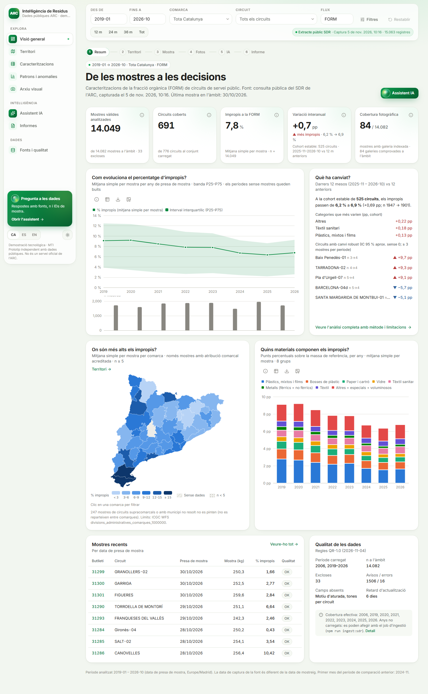

# ARC · Intel·ligència de Residus

**Demostración tecnológica de MTI.** No es un servicio oficial de la Agència de Residus de Catalunya.

Plataforma web para explorar las caracterizaciones públicas de **FORM** (fracción orgánica, circuitos de servicio público) del SDR de la ARC: encontrar patrones y consultar los resultados con IA y evidencias. Recorrido completo: **resumen → territorio/circuito → muestra → fotografías → pregunta a la IA → informe**.



## Qué contiene

- **Datos públicos reales y verificables**: 15.063 boletines (años 2006 y 2019–2026) de la exportación oficial del SDR, con capa raw inmutable (hash, URL, parámetros y fecha de captura). El cálculo reproduce el 100 % de los porcentajes publicados.
- **Ocho secciones** en catalán (español e inglés preparados):
  - Visió general
  - Territori (mapa ICGC + comparación de 2–4 entidades)
  - Caracteritzacions (tabla con servidor + ficha con fórmula visible)
  - Patrons i anomalies
  - Arxiu visual
  - Assistent IA
  - Informes (dossier PDF/CSV)
  - Fonts i qualitat (catálogo, cobertura, reglas, importador)
- **Filtros globales en la URL**, compartidos por KPI, gráficos, mapa, tabla, exportaciones, informes e IA.
- **Asistente con herramientas tipadas** (`get_metric`, `compare_circuits`, `find_anomalies`, `get_sample`, `search_documents`, `get_photos`, `create_report`). Cada cifra lleva periodo, unidad, denominador, n, dataset e IDs. Sin clave de API funciona en **«Mode demostració sense model connectat»** con consultas guiadas deterministas.
- **Tres modos de datos separados**: `public_snapshot`, `imported` (importador CSV/XLSX/JSON) y `synthetic_demo` (territorios y circuitos ficticios, marcados).

## Requisitos

Node.js ≥ 20.9 (probado con 24.14) y npm. Para la demo no hace falta ningún servicio externo; las fotografías se leen en vivo del SDR cuando hay conexión.

## Instalación y arranque

```bash
npm ci
cp .env.example .env.local    # opcional: ANTHROPIC_API_KEY para el asistente con modelo
npm run build && npm run start   # http://localhost:3000
# o bien en desarrollo:
npm run dev
```

Los conjuntos de datos ya generados están en `data/snapshots/` y `data/geo/`, así que la app arranca sin descargar nada.

## Variables de entorno (`.env.example`)

| Variable | Por defecto | Uso |
| --- | --- | --- |
| `ANTHROPIC_API_KEY` | vacía | Activa el asistente con modelo (solo en el servidor). Sin ella: consultas guiadas |
| `ARC_AI_MODEL` | `claude-opus-5-5` | Modelo |
| `ARC_AI_EFFORT` | `medium` | Esfuerzo (`low`, `medium`, `high`) |
| `ARC_AI_MAX_TOOL_ROUNDS`, `ARC_AI_MAX_OUTPUT_TOKENS`, `ARC_AI_TOKEN_BUDGET`, `ARC_AI_TIMEOUT_MS` | 6, 8000, 120000, 90000 | Presupuesto por pregunta |
| `ARC_AI_FALLBACKS` | `default` | Fallback del servidor ante rechazos de seguridad (`off` lo desactiva) |
| `SDR_LIVE` | `1` | Lectura en vivo de galerías y miniaturas del SDR (`0` = solo índice local) |
| `SDR_MIN_INTERVAL_MS` / `SDR_IMAGE_MIN_INTERVAL_MS` | 2000 / 250 | Espaciado de las peticiones al SDR |

## Datos: regenerar o ampliar

```bash
npm run ingest:sdr -- --years 2006,2019-2026   # job explícito y reanudable (capas raw + manifiesto)
npm run ingest:photos -- --recent 60 --per-year 3
npm run build:geo          # ICGC WFS → SVG + nomenclátor (usa el GML raw si existe)
npm run build:snapshot     # raw → public_snapshot (idempotente, con revisiones)
npm run build:synthetic    # synthetic_demo (semilla fija)
npm run report:coverage    # docs/COVERAGE.md
```

Las capturas raw del SDR (contienen matrículas y nombres de asistentes) se quedan en local y están excluidas de git; el manifiesto con hashes sí se versiona.

## Calidad

```bash
npm run typecheck && npm run lint && npm run test && npm run build
npm run test:e2e   # Playwright; npx playwright install chromium la primera vez
npm run bench
```

Resultados: 39/39 pruebas unitarias, 5/5 E2E y build OK. Detalle en [docs/TESTING.md](docs/TESTING.md).

## Limitaciones conocidas

- Extracto inicial: los años 2007–2018 no están cargados. La cobertura efectiva se muestra siempre, nunca una etiqueta fija «2006–2026».
- Indicadores exploratorios por masa caracterizada; no están ponderados por toneladas (falta la fuente).
- El indicador de muestra parada («abortada») no figura en la exportación: la regla de 90 kg se aplica sin conocer el motivo.
- Los derechos de reutilización y entrenamiento de las fotografías no están confirmados. Laboratorio de visión: fase posterior, no operativo.
- El asistente con modelo real no se ha probado en vivo en esta entrega (no había clave); el bucle se probó con un SDK simulado.
- El PDF del protocolo FORM 2022 y el logo no estaban en el proyecto. El RAG usa un resumen marcado como tal y la cabecera usa un logotipo tipográfico. Para incorporarlos: `docs/references/protocol-form-2022.pdf` y `public/brand/arc-logo.png`.

## Documentación

- [docs/ARCHITECTURE.md](docs/ARCHITECTURE.md): decisiones, versiones, seguridad y diseño
- [docs/DATA_SOURCES.md](docs/DATA_SOURCES.md): fuentes, verificación e ingesta
- [docs/DATA_DICTIONARY.md](docs/DATA_DICTIONARY.md): modelo de datos y reglas de calidad
- [docs/METHODOLOGY.md](docs/METHODOLOGY.md): fórmulas y métodos (también lo usa el asistente)
- [docs/COVERAGE.md](docs/COVERAGE.md): cobertura por año (generado)
- [docs/TESTING.md](docs/TESTING.md): pruebas y rendimiento medido
- [docs/DEMO.md](docs/DEMO.md): guion de demo de 5 minutos y capturas
- [docs/PILOT.md](docs/PILOT.md): integraciones verificadas, pendientes y preguntas para la ARC
- [db/schema.sql](db/schema.sql): esquema PostgreSQL de destino
